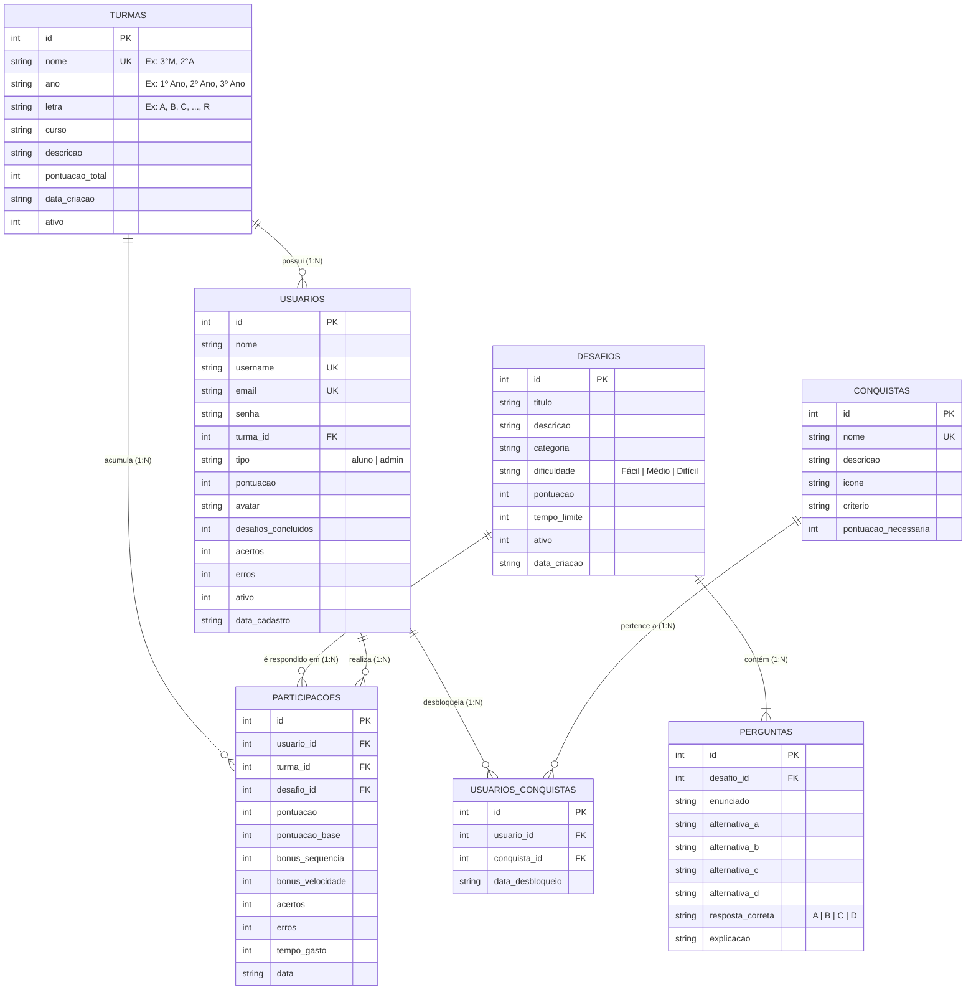

# 🏆 Rivalidade Escolar – Plataforma de Desafios entre Turmas
### Projeto Integrador – EXPOCEEP 2026 | Etapa 1

---

## 📖 1. Sobre o Projeto

O **Rivalidade Escolar** é uma plataforma educacional gamificada desenvolvida para promover o engajamento estudantil e uma competição acadêmica saudável e colaborativa entre as turmas do **CEEP Pedro Boaretto Neto**.

Na plataforma, os estudantes resolvem quizzes e desafios dinâmicos divididos por categorias de conhecimento (Tecnologia, Matemática, Ciências, Conhecimentos Gerais e Conteúdos Escolares). As pontuações individuais dos alunos acumulam pontos de experiência (XP) diretamente para o placar geral de sua respectiva turma, movimentando o ranking escolar em tempo real, desbloqueando medalhas/conquistas e incentivando a união das turmas.

---

## 🎯 2. Escopo da Etapa 1

Nesta **Etapa 1**, o foco principal é a fundação da arquitetura de dados e da infraestrutura da API:
* **Modelagem do Banco de Dados Relacional**: Definição das entidades essenciais do sistema escolar.
* **Diagrama Entidade-Relacionamento (DER)**: Mapeamento de cardinalidades e chaves primárias/estrangeiras.
* **Script SQL DDL (`bd/script.sql`)**: Comandos estruturados com `CREATE TABLE`, `PRIMARY KEY`, `AUTOINCREMENT`, `FOREIGN KEY`, `NOT NULL`, `UNIQUE` e dados sementes (*seeds*).
* **Estrutura Inicial da API em Python (Flask)**: Servidor HTTP com CORS habilitado e rota de verificação `GET /` operando em `http://localhost:5000/`.
* **Ambiente Virtual (`backend/venv`)**: Isolamento de dependências com `requirements.txt`.
* **Versionamento e Git**: Configuração de `.gitignore` para proteção de arquivos de ambiente, banco local (`.db`) e diretório `venv/`.
* **Preservação Integral do Front-End**: Manutenção de todos os componentes, páginas e rotas React/TypeScript já existentes.

---

## 🛠️ 3. Tecnologias Utilizadas

| Camada | Tecnologia | Descrição |
| :--- | :--- | :--- |
| **Front-End** | **React 18 + TypeScript + Vite** | Interface moderna, responsiva e performática |
| **Estilização** | **Tailwind CSS + Lucide Icons** | Design system consistente e responsivo |
| **Back-End** | **Python 3 + Flask + Flask-CORS** | API RESTful modular e escalável |
| **Banco de Dados** | **SQLite 3 + SQL DDL ANSI** | Armazenamento relacional com suporte a chaves estrangeiras |
| **Ambiente Python** | **venv + pip** | Gestão de pacotes e isolamento de dependências |

---

## 📊 4. Modelagem do Banco de Dados (DER)

### 4.1. Diagrama de Entidades e Relacionamentos (Mermaid)



### 4.2. Estrutura Textual das Relações
1. **`TURMAS` (1) ──── (N) `USUARIOS`**: Cada turma abriga múltiplos alunos. O aluno seleciona seu ano (1º, 2º ou 3º) e a letra da turma (A até R).
2. **`DESAFIOS` (1) ──── (N) `PERGUNTAS`**: Um desafio pedagógico agrupa várias perguntas de múltipla escolha com 4 alternativas (A, B, C, D) e gabarito.
3. **`USUARIOS` (1) ──── (N) `PARTICIPACOES`**: Cada tentativa de responder a um desafio gera um registro com pontuações, bônus de agilidade e tempo gasto.
4. **`TURMAS` (1) ──── (N) `PARTICIPACOES`**: As participações alimentam a somatória de pontos da turma no ranking geral.
5. **`USUARIOS` (N) ──── (N) `CONQUISTAS`**: Relação de muitos-para-muitos mediada pela tabela associativa `USUARIOS_CONQUISTAS`.

---

## 📁 5. Estrutura de Pastas do Projeto

```text
rivalidade-escolar/
│
├── .gitignore               # Configurações de exclusão do Git (venv, .db, node_modules)
├── README.md                # Documentação técnica e instruções da Etapa 1
├── package.json             # Dependências e scripts do Front-End (Vite/React)
├── tsconfig.json            # Configuração do compilador TypeScript
├── vite.config.ts           # Configuração de build do Vite
├── index.html               # Ponto de entrada HTML da aplicação
│
├── bd/                      # Diretório de Banco de Dados
│   └── script.sql           # DDL com CREATE TABLE, índices relacionais e seeds iniciais
│
├── backend/                 # Diretório da API Python Flask
│   ├── app.py               # Servidor Flask com CORS e rota GET /
│   ├── requirements.txt     # Dependências da API (Flask, Flask-CORS)
│   └── venv/                # Ambiente virtual Python isolado (ignorado pelo git)
│
└── src/                     # Código-fonte do Front-End existente
    ├── components/          # Componentes visuais da interface
    ├── context/             # Gerenciamento de estado (Auth, Dados, Notificações)
    ├── data/                # Dados mockados e tipos de teste
    ├── App.tsx              # Componente raiz da aplicação
    ├── index.css            # Estilos globais Tailwind CSS
    ├── main.tsx             # Ponto de montagem React DOM
    └── types.ts             # Interfaces TypeScript das entidades
```

---

## 🚀 6. Como Executar o Projeto

### 6.1. Pré-requisitos
* **Node.js** (versão 18 ou superior) e **npm**
* **Python** (versão 3.10 ou superior)

---

### 6.2. Executando o Back-End (Flask)

1. Abra um terminal e navegue até a pasta `backend/`:
   ```bash
   cd backend
   ```

2. Crie o ambiente virtual Python (`venv`):
   ```bash
   python -m venv venv
   ```
   *(ou `python3 -m venv venv` conforme seu sistema)*

3. Ative o ambiente virtual:
   * **Windows (PowerShell):**
     ```powershell
     .\venv\Scripts\activate
     ```
   * **Windows (Prompt de Comando CMD):**
     ```cmd
     .\venv\Scripts\activate.bat
     ```
   * **Linux / macOS:**
     ```bash
     source venv/bin/activate
     ```

4. Instale as dependências listadas no `requirements.txt`:
   ```bash
   pip install -r requirements.txt
   ```

5. Inicie o servidor Flask:
   ```bash
   python app.py
   ```

6. O servidor estará rodando em:
   ```text
   http://localhost:5000/
   ```

7. **Teste a rota da Etapa 1:**
   Acesse no navegador ou via cURL:
   ```bash
   curl http://localhost:5000/
   ```
   **Resposta esperada (Status 200 OK):**
   ```json
   {
     "status": "sucesso",
     "mensagem": "API do Rivalidade Escolar rodando com sucesso na Etapa 1!"
   }
   ```

---

### 6.3. Executando o Front-End (React + Vite)

Em outro terminal na raiz do projeto (`rivalidade-escolar`):

1. Instale as dependências:
   ```bash
   npm install
   ```

2. Inicie o servidor de desenvolvimento:
   ```bash
   npm run dev
   ```

3. Acesse a aplicação no seu navegador:
   ```text
   http://localhost:3000/
   ```

---

## 🗄️ 7. Banco de Dados SQLite

O script completo de criação das tabelas encontra-se em `bd/script.sql`.

Para testar ou criar manualmente um banco SQLite local:
```bash
# Na raiz do projeto:
sqlite3 bd/rivalidade_escolar.db < bd/script.sql
```

> **Atenção:** O arquivo `.db` gerado localmente é ignorado pelo `.gitignore` e não deve ser commitado no repositório GitHub.

---

## 📌 8. Planejamento das Etapas (EXPOCEEP 2026)

* [x] **ETAPA 1 (Atual):**
  - Levantamento e modelagem das entidades do Rivalidade Escolar;
  - Criação do DER e script `bd/script.sql`;
  - Estrutura base da API Flask com rota `/` de verificação;
  - Criação de `requirements.txt` e configuração de `venv`;
  - Atualização do `.gitignore` para padrões de segurança e limpeza;
  - Preservação total do Front-End existente.

* [ ] **ETAPA 2 (Próxima):**
  - Implementação das rotas RESTful com CRUD completo (`GET`, `POST`, `PUT`, `DELETE`);
  - Conexão do Flask com o banco de dados SQLite;
  - Endpoints de autenticação, pontuação, turmas e submissão de desafios;
  - Validação de requisições e testes funcionais com Thunder Client / Postman;
  - Integração das chamadas da API ao Front-End React.
